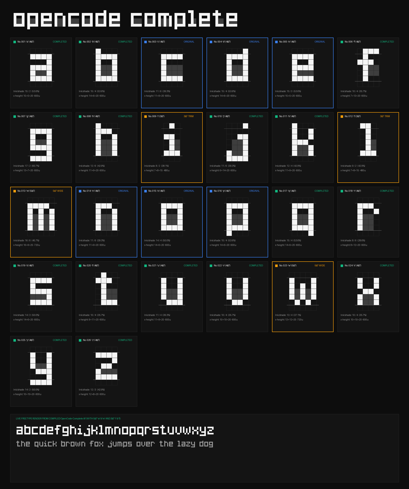

# OpenCode Complete — 26-Letter Unicase Typeface

Complete **26-letter unicase alphabet** (`a`–`z` / `A`–`Z`) extending the 6-glyph **OpenCode** wordmark typeface (`o`, `p`, `e`, `n`, `c`, `d` from [opencode.ai/font](https://opencode.ai/font)) using its exact modular construction rules, `120u` stroke geometry, corner-stepping logic, and lower-counter shade (`shadow`) architecture.

## Highlights (Edition 2.100)

- **26 Unicase Letters (`a`–`z` / `A`–`Z`):** No separate uppercase or lowercase; both cases map to the 26 canonical letter glyphs.
- **Modular Grid (`1 module = 6 SVG units = 120 font units`):**
  - Standard letters: `4 × 7` modules (`24 × 42` SVG units, `600u` advance width).
  - Wide 3-stem letters (`w`, `m`): `5 × 7` modules (`+1` module width, `30 × 42` SVG units, `720u` advance width) so three `1`-module stems enclose two distinct `1`-module counters.
  - Narrow symmetric stems (`i`, `l`): `3 × 7` modules (`-1` module trim, `18 × 42` SVG units, `480u` advance width) centering the stem between symmetric `1`-module serifs.
- **Uniform `120u` Inter-Letter Gap:** Every letter has `60u` left and `60u` right sidebearings (`0` kerning).
- **Strict `1:1` Stroke Contrast (`120u / 120u`, $\sigma = 0$):** Zero curves, zero diagonals, and zero `2 × 2` solid ink blocks.
- **Two-Tone Wordmark Layers (`ink` + `shadow`):** Counter shade fills only the lower half of the x-height counter (`rows 3..5`), leaving `row 2` unshaded.

## Files

- `index.html` — Interactive web specimen, two-tone SVG wordmark typewriter, 30° isometric exploded view, variant switcher, live pixel editor, 26 glyph passports, waterfall, and live font tester.
- `OpenCode-Complete.ttf` — Installable TrueType font binary.
- `glyphs.mjs` — Drop-in 26-letter SVG (`ink` + `shadow`) module matching `opencode.ai/font/glyphs.mjs`.
- `font.mjs` — Drop-in `opentype.js` font generator module matching `opencode.ai/font/font.mjs`.
- `build_font.py` — Reproducible Python builder and invariant verifier script.
- `specimen.png` — High-resolution 26-glyph passport and FreeType pangram specimen sheet.
